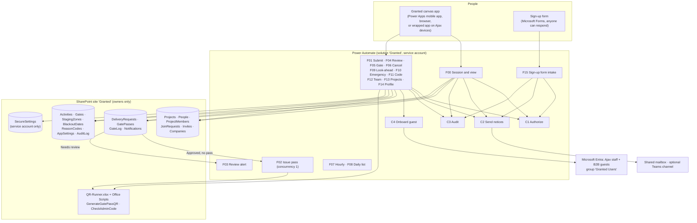
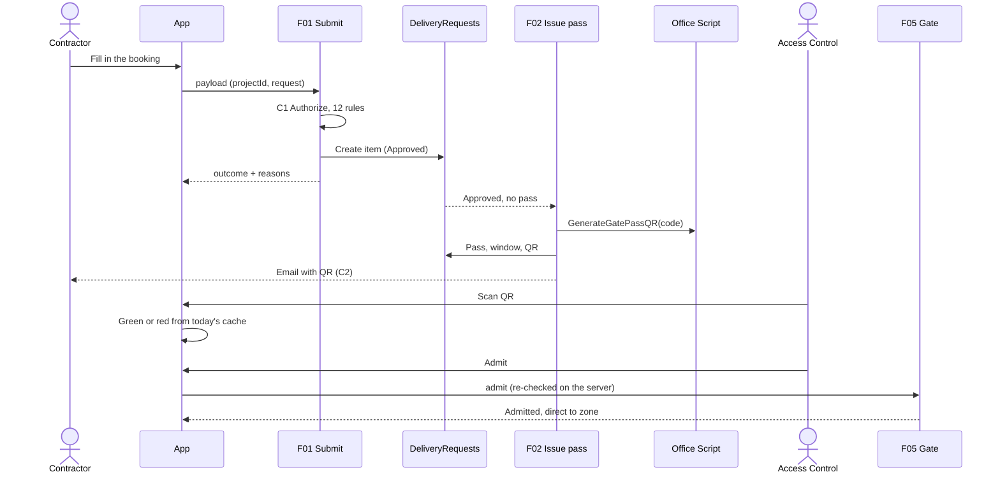

# 01 · Architecture

Everything runs inside Ajax's Microsoft 365 tenant, on standard connectors. The app has **no SharePoint connection**: it calls flows, and the flows, running as one service account, are the only thing that touches the lists. That gives GrantedPA the same shape as the custom app. The flows play the API's part, checking who is calling and what they may do on that project before every read and write.

## Why it's shaped this way

| Choice | Reason |
|---|---|
| The app reads and writes only through flows | Guests can't open the lists, so they can't get around the app's rules. Every permission check is in one place (C1), like the custom app's API. |
| One site, `ProjectId` on every row | One app and one set of flows serve every project. SharePoint data sources can't be switched at run time, so a site per project would need an app per project. |
| Effective role decided by the server (C1) | Maintenance mode can't be faked from the app, and it can only narrow access |
| F01, F02, F05 and F10 run one at a time | The last slot can't be double-booked, and a pass can't be admitted twice |
| QR codes and the admin code check are Office Scripts | No premium connector or outside service. Both scripts are tested in this repository. |
| The gate keeps today's passes on the device | A weak signal doesn't stop deliveries; admits queue and sync |
| Sign-up form for outsiders | People need a guest account before they can open the app. The form collects the design's sign-up fields with no licence, and approval creates the guest. |
| Child flows in a solution | Shared logic (authorize, notify, audit, onboard) is written once. Solutions are also needed for wrap and for environment variables. |

## Main sequence: booking to gate

